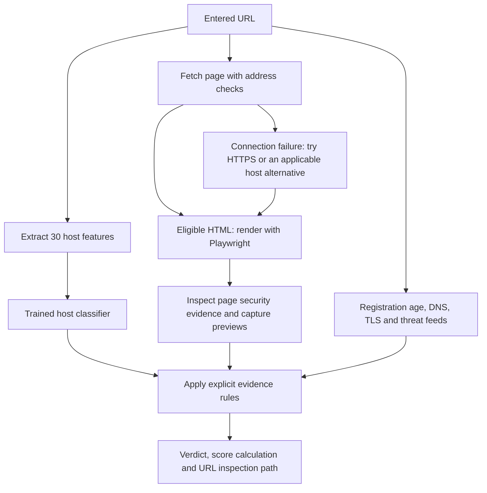

# PhishGuard 🛡️

[](https://github.com/Quantm56/PhishGuard/actions/workflows/ci.yml)
[](https://www.python.org/)
[](LICENSE)

**PhishGuard** is an Information Security project for explainable phishing detection through a local web dashboard, REST API and Chrome extension. It combines a trained host classifier with page inspection, domain and certificate information, and threat intelligence.

The deployed system uses **30 host features plus explicit security rules for inspected page content**. It reports the evidence behind each verdict, the addresses it actually inspected, and information it could not retrieve. There are no website-specific score overrides.

## Contents

- [Features](#features)
- [Quick start](#quick-start)
- [Chrome extension](#chrome-extension)
- [Detection pipeline](#detection-pipeline)
- [Understanding results](#understanding-results)
- [API reference](#api-reference)
- [Configuration and API keys](#configuration-and-api-keys)
- [Testing](#testing)
- [Model training and evaluation](#model-training-and-evaluation)
- [Project structure](#project-structure)
- [Security and limitations](#security-and-limitations)
- [License and dataset credit](#license-and-dataset-credit)

## Features

- **Host analysis:** hostname structure, entropy, IP-address hosts, unusual ports, punycode and brand-impersonation patterns.
- **Page security evidence:** password collection over HTTP, credential forms submitting to external domains, title-brand impersonation and other explicit rules.
- **Static and dynamic inspection:** HTTP retrieval followed by Playwright Chromium rendering for eligible HTML pages, including pages whose initial HTML already contains text.
- **Visual previews:** separate snapshots of static HTML with JavaScript disabled and the rendered DOM, with captured source available separately.
- **Address recovery:** HTTPS and applicable bare-domain/`www` alternatives after connection failure, with recovery attempts distinguished from actual redirects.
- **Inspection path:** entered URL, failed attempts, recovery, HTTP redirect hops, browser/client navigation and final inspected address.
- **Infrastructure details:** RDAP/optional WHOIS registration age, DNS addresses and TLS certificate identity, validity, hostnames, fingerprint and leaf PEM.
- **Threat intelligence:** OpenPhish, PhishTank, URLhaus, Google Safe Browsing and VirusTotal, shown once per provider with per-address evidence.
- **Readable explanations:** feature guidance, independent model what-if checks and a sequential score calculation.
- **Pre-navigation Chrome checks:** a checking page, warning/error states, temporary navigation allowances and an evidence popup.

## Quick start

### Requirements

- Python 3.10 or later; the CI matrix covers Python 3.10–3.13 on Ubuntu and Windows.
- Git and a browser.
- Playwright Chromium for rendered DOM inspection and visual previews.

The trained host model is included. Downloading the training dataset or retraining is **not required** to run the application.

### 1. Get the project

```bash
git clone https://github.com/Quantm56/PhishGuard.git
cd PhishGuard
```

### 2. Create and activate a virtual environment

**Linux / macOS**

```bash
python3 -m venv .venv
source .venv/bin/activate
```

**Windows PowerShell**

```powershell
python -m venv .venv
.\.venv\Scripts\Activate.ps1
```

### 3. Install dependencies and Chromium

```bash
python -m pip install -r requirements.txt
python -m playwright install chromium
```

If Playwright reports missing Linux system libraries, use its dependency installer:

```bash
python -m playwright install --with-deps chromium
```

### 4. Configure optional integrations

Copy `.env.example` to `.env` if `.env` does not already exist:

```bash
# Linux / macOS
cp .env.example .env
```

```powershell
# Windows PowerShell
Copy-Item .env.example .env
```

Leave optional API-key fields empty to start without those integrations. The server loads the project's `.env` automatically; existing environment variables take precedence. See [API_KEYS.md](API_KEYS.md) for provider setup and verification.

### 5. Start the server

```bash
python api.py
```

Open [the dashboard](http://127.0.0.1:5000/) and enter a URL. Keep **Live Enrichment** enabled for page inspection, visual previews and network intelligence. Disable it for offline host analysis and URL rules.

Restart the server after changing Python code or environment settings.

## Chrome extension

1. Start the local Python server.
2. Open `chrome://extensions` in Chrome.
3. Enable **Developer mode**.
4. Select **Load unpacked** and choose this repository's `extension/` directory.
5. Navigate to an HTTP or HTTPS website, then open the PhishGuard popup to inspect its result.

The Manifest V3 extension uses Declarative Net Request rules to send top-level web navigations to its checking page. Localhost and the local dashboard are exempt.

| Result | Behaviour |
| --- | --- |
| `LEGITIMATE` / **SAFE** | Creates a temporary tab navigation allowance and continues. A verified same-domain HTTPS recovery address can be used when the submitted address failed. |
| `SUSPICIOUS` / **CHECK** | Shows a warning with evidence and a choice to go back or explicitly proceed. |
| `PHISHING` / **RISK** | Shows a high-risk warning with evidence and an explicit proceed confirmation. |
| API error or timeout | Shows an error and user choices; does not automatically treat the URL as safe. |

The popup includes the score, explanation, URL path, provider checks, certificate details and captured page previews. **Scan again** starts a fresh verification. Navigation allowances are removed after loading or expiration.

The default API address and 45-second checking timeout are configured in [extension/config.js](extension/config.js). If you change the server port, update the extension's API address and host permissions accordingly. Reload the extension after changing its files.

## Detection pipeline



### URL handling and recovery

A leading `www` and the URL scheme do not directly change the host model's lexical features. The actual submitted URL is retained for fetching, URL rules and threat lookups.

If an address times out, cannot connect or fails DNS resolution, the fetcher can try HTTPS on the same host and then the applicable HTTPS bare-domain/`www` alternative. Paths and queries are preserved. It does not add `www` to functional subdomains such as `portal.example.com`, downgrade HTTPS to HTTP, or try aliases after a private-address block or certificate failure. A returned HTTP error page is not silently replaced with another host's response.

Recovery is **not** presented as a redirect. The inspection path shows what actually happened. Different hosts are not assumed to serve identical content, and a threat listing on the submitted address is retained when another address is inspected.

### DOM capture

The browser waits for stable visible content and controls, visible loading indicators, and relevant images, backgrounds and fonts within bounded waits. Changing analytics scripts and nonces do not prevent the visible page from settling.

The interface distinguishes a settled capture from a rendering time limit or unfinished assets. A JavaScript-only site's **static HTML preview may be blank**; its rendered DOM preview shows the page after script execution. Previews are non-interactive images, while source text is available separately, limited to 100,000 characters with a truncation notice.

### Deployed model policy

`models/model_host.joblib` supplies the trained model estimate. Page security rules and live infrastructure evidence then update that estimate. Curated brand-ownership metadata supports impersonation checks; it does not assign a fixed verdict to a website.

The legacy `model_full.joblib` remains an archival artifact and is **not loaded by the API**. It learned unreliable layout shortcuts, including treating a low internal-link count as strong phishing evidence. Missing navigation links, images, titles or social links no longer determine the learned model estimate. The current training script produces the host model only.

## Understanding results

| Verdict | Final score |
| --- | --- |
| `LEGITIMATE` | Below 40% |
| `SUSPICIOUS` | 40% to below 70% |
| `PHISHING` | 70% or above |

A configured threat provider reporting a listing triggers a phishing verdict. A lower-risk result is not a guarantee that a site is safe. The displayed score is an evidence-adjusted model estimate, **not a validated real-world probability of maliciousness**.

### Score calculation

The **How this score was calculated** table starts with the model estimate and shows each rule's resulting percentage-point change in order. Rules operate on log-odds:

```text
logit(p) = ln(p / (1 - p))
p_after = sigmoid(logit(p_before) + rule_delta)
```

The displayed changes add up to the final score, including any explicit override or limit. Raw heuristic weights are not percentage points. For example, an estimate of 99.31% with a +0.2 log-odds update becomes approximately 99.43%, a change of about +0.12 percentage points.

### Model what-if checks and feature colours

Each what-if row independently replaces one feature with a training baseline. These effects overlap and **must not be added together**. They explain the host model estimate before rules.

- **Green:** a favourable observation or absent review indicator.
- **Red:** an indicator requiring review in context.
- **Neutral:** no universal good/bad cutoff, such as hostname length or entropy.

Individual feature values do not prove safety or phishing.

### Provider status and certificate evidence

Each provider appears once. Expand its checked addresses to see the submitted and final URL results. A threat hit is retained, and an unavailable lookup is not hidden by a clean result for another address.

| Status | Meaning |
| --- | --- |
| `listed` | The provider reported a threat match. |
| `clean` | No match in that provider's checked data; not a general safety guarantee. |
| `skipped` | The check was not enabled or applicable, such as a missing API key. |
| `unavailable` | No usable answer, for example due to a timeout, quota or absent VirusTotal report. |

Unknown registration age has no risk penalty. A valid TLS certificate verifies connection/hostname properties, not the website's trustworthiness. The certificate viewer shows the leaf certificate, not a full certificate chain.

## API reference

The default base address is [http://127.0.0.1:5000](http://127.0.0.1:5000).

### `POST /api/predict`

```bash
curl -X POST http://127.0.0.1:5000/api/predict \
  -H 'Content-Type: application/json' \
  -d '{"url":"https://example.com/","live":true,"fetch_page":true}'
```

| Request field | Type | Behaviour |
| --- | --- | --- |
| `url` | String, required | URL to assess; maximum 4,096 characters. A missing scheme defaults to HTTP. |
| `live` | Boolean | Defaults to `true`; enables network intelligence and, by default, page inspection. |
| `fetch_page` | Boolean | Defaults to the `live` value. `false` skips page retrieval; it does not disable live intelligence. `live:false` disables all live checks. |

For offline testing, send `{"url":"https://example.com/","live":false}`.

Key response fields:

| Field | Contents |
| --- | --- |
| `url`, `host`, `registered_domain`, `effective_url` | Submitted identity and final observed address. |
| `verdict`, `final_score`, `reason`, `thresholds` | Assessment and threshold values; scores use the range 0–1. |
| `model_used`, `model_name`, `ml_probability`, `model_policy` | Classifier and inspection policy. |
| `signals`, `score_breakdown` | Rule evidence, actual percentage-point changes and sequential calculation. |
| `explanation`, `host_features`, `feature_assessments` | Model what-if checks, extracted values and display guidance. |
| `url_context` | Fetch attempts, recovery flags and ordered `journey` steps. |
| `page` | When a live page fetch is requested: inspection status, content observations, captured source, visual previews and rendering readiness. |
| `osint` | `whois`, `dns`, `tls`, and `threat_intel` results; `null` in offline mode. |
| `navigation_url` | Optional verified HTTPS recovery destination for lower-risk, inspected, same-domain navigation. |

Preview images are JPEGs encoded as base64 in `page.previews`. Provider-specific URL checks are in `osint.threat_intel[].checks`. The legacy `rule_adjustment` field contains heuristic weights; use `score_breakdown` for displayed arithmetic.

Malformed or missing URL input returns HTTP 400; an unexpected assessment failure returns HTTP 500.

### Other endpoints

| Endpoint | Purpose |
| --- | --- |
| `GET /` | Web dashboard. |
| `GET /api/health` | Server status and Boolean API-key presence flags in `integrations`; key values are never returned. Presence does not validate authentication. |
| `GET /api/metrics` | Stored evaluation report and active deployment policy. Historical full-model results, if present, are archival. |
| `GET /results/<name>` | Files from the results directory, including evaluation plots. |

## Configuration and API keys

| Variable | Purpose |
| --- | --- |
| `HOST` | Server bind address; defaults to `127.0.0.1`. |
| `PORT` | Server port; defaults to `5000`. |
| `GSB_API_KEY` | Google Safe Browsing v4. |
| `VT_API_KEY` | VirusTotal v3 report lookups. |
| `URLHAUS_AUTH_KEY` | abuse.ch URLhaus authentication. |
| `PHISHTANK_APP_KEY` | Optional PhishTank application key. |

RDAP, DNS, TLS and the OpenPhish community feed need no API key. The PhishTank implementation can attempt a lookup without an application key. Provider availability, quotas and access policies still apply.

Keep keys in the server's `.env`, which is ignored by Git, rather than in extension or dashboard JavaScript. Follow [API_KEYS.md](API_KEYS.md) for account setup, restrictions, provider limits and verification. Restart the server after editing keys.

## Testing

Run the automated suite from the project root:

```bash
python -m unittest discover -s tests -v
```

The current suite contains **85 tests**, covering API contracts, URL recovery, private-address blocking, certificate parsing, retained threat hits, provider de-duplication, score arithmetic, layout-bias regressions, DOM rendering and inspection paths. Browser-rendering dependencies are mocked in relevant unit tests; running the suite alone does not validate third-party availability or complete browser behaviour.

Use [TEST_URLS.md](TEST_URLS.md) for ten manual test URLs and their expected checks. For a complete manual check:

1. Verify both HTTP/HTTPS and bare-domain/`www` forms of a site.
2. Compare inspected addresses, page inspection status, verdicts and evidence.
3. Expand the URL inspection path and provider address checks.
4. Inspect the static and rendered visual previews and certificate details.
5. Test the extension with the API running and stopped; an API failure must remain an error state.

Synthetic hostname tests do not establish threat-feed coverage or overall detection accuracy.

## Model training and evaluation

### Retraining

Obtain the PhiUSIIL CSV using [data/README.md](data/README.md) and place it at `data/PhiUSIIL_Phishing_URL_Dataset.csv`.

```bash
python train.py
```

For a smaller training run:

```bash
python train.py --sample 20000
```

Training recomputes host features, creates domain-grouped train/validation/test partitions, augments training-only subdomains, compares classifiers, and selects a model using validation F1. It writes `models/model_host.joblib`, `results/metrics.json`, the training log and plots. A sample run also overwrites these outputs, so preserve artifacts you want to keep before retraining. Restart the API to load a newly trained model.

### Stored host-model benchmark

The following values are from the **committed `results/metrics.json`**, not a new evaluation of the complete live pipeline. The report records 235,370 deduplicated URLs and 34,634 held-out test URLs, with registered domains grouped across the split.

| Metric | Stored HistGradientBoosting host model |
| --- | ---: |
| Accuracy | 75.12% |
| Precision | 95.97% |
| Recall | 41.39% |
| F1 | 57.83% |
| ROC-AUC | 0.8064 |
| False-positive rate | 1.22% |

These classification metrics use the training evaluation threshold of **0.5**. The application uses **0.4 / 0.7** verdict thresholds and additional live rules. The stored report therefore does not measure current end-to-end live accuracy. Its limited recall is one reason to retain content inspection and independent intelligence sources; those additions also need their own evaluation.

The archive may include high-scoring full-model results. That classifier is retired because its dataset performance did not generalise reliably to real page layouts. Earlier training artifacts have not been presented as a fresh retraining of the current policy.

## Project structure

```text
PhishGuard/
├── api.py                    # Flask dashboard and API
├── train.py                  # Host-model training and evaluation
├── phishguard/
│   ├── predictor.py          # Assessment, evidence rules and score calculation
│   ├── urlfeatures.py        # URL parsing and 30 host features
│   ├── content.py            # Fetching, recovery, rendering and previews
│   ├── intel.py              # Network intelligence and provider aggregation
│   ├── journey.py            # Ordered URL inspection path
│   ├── feature_display.py    # Context-aware feature guidance
│   └── brands.py             # Impersonation metadata and rule tables
├── extension/                # Chrome MV3 checking page, popup and service worker
├── templates/index.html      # Web dashboard
├── models/
│   ├── model_host.joblib     # Deployed trained classifier
│   └── model_full.joblib     # Retired archival classifier
├── results/                  # Stored metrics, plots and training log
├── tests/                    # Automated regression and API tests
├── data/README.md            # Training dataset instructions
├── .github/workflows/ci.yml  # Automated test workflow
├── .env.example              # Server configuration template
├── API_KEYS.md               # Integration setup and detailed behaviour
├── TEST_URLS.md              # Manual testing checklist
├── requirements.txt          # Runtime dependencies
├── pyproject.toml            # Package metadata
├── CONTRIBUTING.md
└── LICENSE
```

## Security and limitations

- **Local use:** the API defaults to loopback. It has no authentication and uses permissive CORS; it is not configured as a public hosted service.
- **Destination checks:** page retrieval and browser routing check public-address resolution and block private, loopback and link-local destinations. HTTP redirects and browser subresources are checked; browser service workers are disabled.
- **Bounded work:** static retrieval uses a 2,000,000-byte cutoff, six-second request timeouts and up to five followed redirects. Browser rendering, visual assets and screenshots have bounded waits; an entire live scan includes multiple operations.
- **Browser execution:** Playwright executes target JavaScript in a separate browser context. The current launch configuration disables Chromium's OS sandbox, so context separation and route checks should not be described as a hardened execution sandbox.
- **TLS evidence:** certificate verification failures remain visible and influence rules. Static fetching can inspect an unverified payload while preserving the failure flag; HTTPS recovery results with failed verification are rejected.
- **Incomplete evidence:** bot challenges, authentication requirements, network failures, unsupported registration lookups and provider quotas can prevent complete inspection. The interface reports those gaps rather than turning them into clean results.
- **Coverage:** host ML, curated impersonation metadata and heuristic evidence rules can miss attacks or produce false positives. Neither a valid certificate nor an absent feed match proves legitimacy. Compromised sites and behaviour after user interaction may be outside the captured evidence.
- **Data sent to providers:** live scans make server-side requests to the target and configured intelligence services. Source/previews represent the scanner's view, not the user's authenticated browser session.

## License and dataset credit

Project code is distributed under the [MIT License](LICENSE). See [CONTRIBUTING.md](CONTRIBUTING.md) for contribution guidance.

Training data: **PhiUSIIL Phishing URL (Website)**, Arvind Prasad and Shalini Chandra, available from the [UCI Machine Learning Repository](https://archive.ics.uci.edu/dataset/967/phiusiil%2Bphishing%2Burl%2Bdataset). The dataset is distributed separately under CC BY 4.0; consult its source for citation and attribution requirements.
